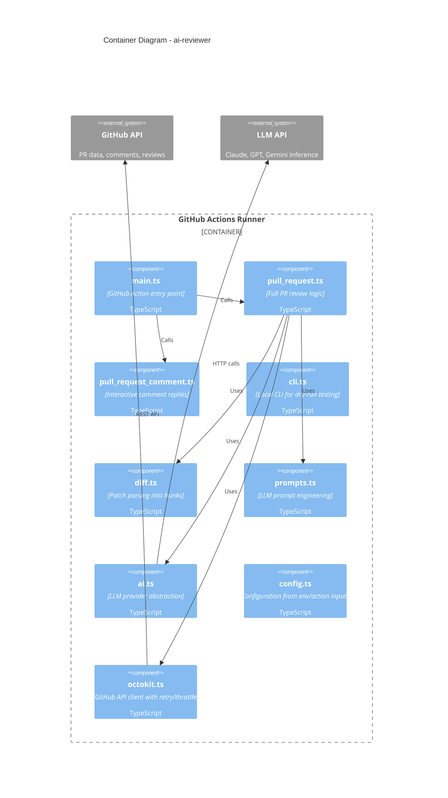
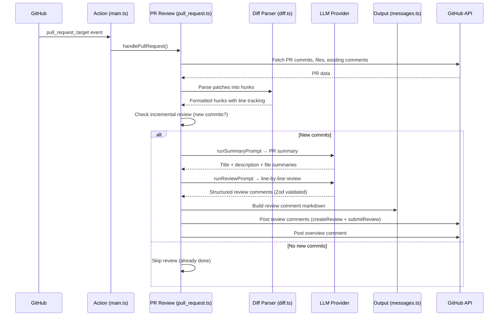
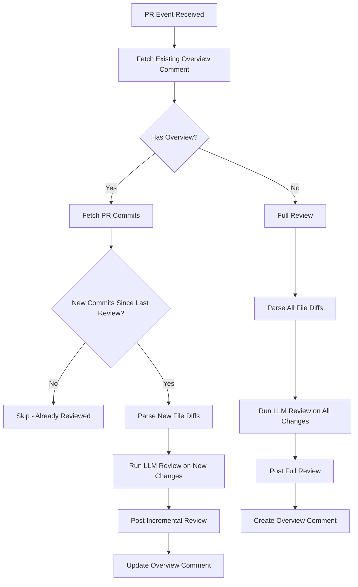
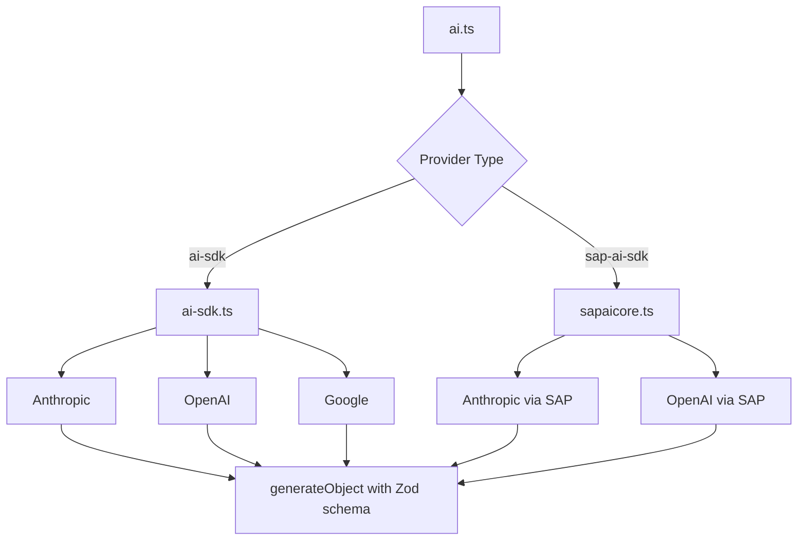
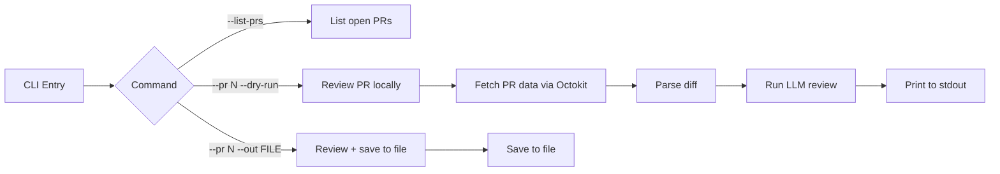

# ai-reviewer — ARCHITECTURE.md

## System Overview

GitHub Action que proporciona revisión automatizada de código con IA para Pull Requests. Analiza diffs, genera sugerencias línea por línea, crea resúmenes automáticos y responde a comentarios interactivos.

---

## C4 Context Diagram

```mermaid
C4Context
    title System Context - ai-reviewer
    Person(dev, "Developer", "Crea Pull Requests y recibe revisiones automatizadas")
    System(github, "GitHub", "PR management + Actions runner")
    System(ai_reviewer, "ai-reviewer", "AI-powered PR review GitHub Action")
    System(llm, "LLM Provider", "Anthropic / OpenAI / Google / SAP AI Core")

    Rel(dev, github, "Creates PR")
    github --> ai_reviewer: Triggers on pull_request
    ai_reviewer --> llm: Sends diff + context
    llm -->> ai_reviewer: Review suggestions
    ai_reviewer --> github: Posts review comments
```

---

## C4 Container Diagram



---

## PR Review Flow



---

## Incremental Review Algorithm



---

## Diff Parsing

### Hunk Structure

GitHub patches are parsed into `Hunk` objects:

```typescript
interface Hunk {
  file: string;
  newHunk: string;   // Format: __new hunk__\n<line_number>: <content>\n
  oldHunk: string;   // Format: __old hunk__\n<line_number>: <content>\n
  startLine: number;
  endLine: number;
  existingThreads: ReviewCommentThread[];
}
```

### LLM-Optimized Format

Diffs are reformatted for optimal LLM consumption:

```
__new hunk__
42: const result = await fetch(url);
43: const data = JSON.parse(result);  // ← potential issue here
```

---

## Prompt Engineering

Three main prompts in `src/prompts.ts`:

### 1. Summary Prompt

Generates PR title, description, and per-file summaries.

**Output Schema (Zod):**
```typescript
{
  title: string;
  description: string;
  fileSummaries: { file: string; summary: string }[];
}
```

### 2. Review Prompt

Generates line-by-line review comments.

**Output Schema (Zod):**
```typescript
{
  comments: {
    file: string;
    line: number;
    lineEnd: number;
    message: string;
    label: string;  // bug | security | performance | style | docs
    critical: boolean;
  }[];
}
```

### 3. Comment Reply Prompt

Generates replies to user review comments.

---

## LLM Provider Abstraction



### Model Registry

| Provider | Models |
|----------|--------|
| Anthropic | claude-3.5-sonnet, claude-3.7-sonnet, claude-4-opus |
| OpenAI | gpt-4o, gpt-5, o1, o3, o4 |
| Google | gemini-1.5-pro, gemini-2.0, gemini-2.5 |

---

## Security Architecture

### GitHub Action Permissions

```yaml
permissions:
  contents: read
  pull-requests: write
  issues: write
```

### Why `pull_request_target` vs `pull_request`

`pull_request_target` is used because:
- It runs in the context of the base branch (safe for this use case — no code execution from PR)
- Allows posting comments to PRs from forked repositories
- The action only reads PR data and posts comments; it never executes PR code

### Security Best Practices

- API keys stored as GitHub secrets, never in code
- LLM prompts sanitized to prevent prompt injection from code comments
- Octokit configured with retry + throttling to prevent rate limit issues

---

## CLI Architecture



---

## Deployment

### GitHub Action

```yaml
# action.yml
name: 'Presubmit AI Reviewer'
runs:
  using: 'node20'
  main: 'dist/index.js'
```

### Build Output

| File | Size | Purpose |
|------|------|---------|
| `dist/index.js` | ~1.8MB | Bundled GitHub Action entry point |
| `dist/cli.js` | ~1.8MB | Bundled CLI entry point |

Built with esbuild for production optimization.
